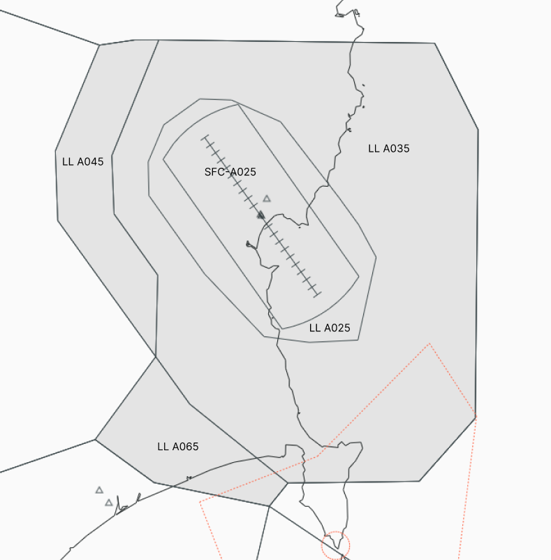
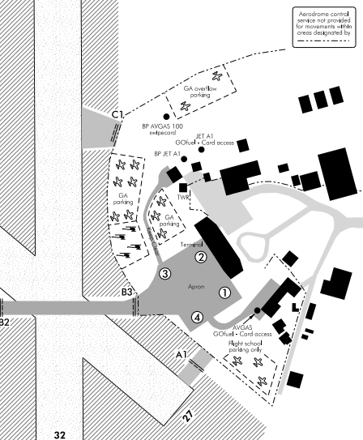
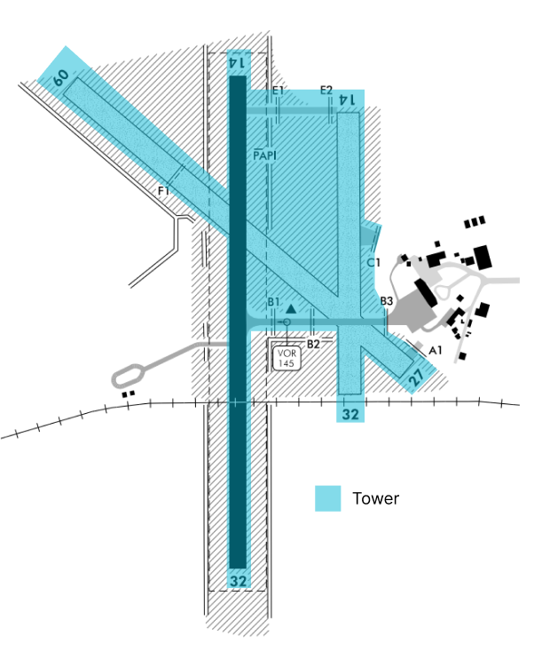

--8<-- "includes/abbreviations.md"

## Control Positions and Navaids

| Position Name   | Shortcode  | Callsign         | Frequency   | Login ID       | Usage      |
| --------------- | ---------- | ---------------- | ----------- | ---------------| ---------- |
| Gisborne ADC    | TGS        | Gisborne Tower   | 127.300     | NZGS_TWR       | Primary    |

## Airspace

The Gisborne CTR/D follows the inner lateral boundaries shown below from `SFC` to `A025`. 

The wider Gisborne CTA/D follows the outer boundaries as shown below, with the vertical boundaries also listed in their respective sector. Gisborne's airspace tops out at `A095`.

Gisborne Tower provides a Procedural Approach service for the wider CTA/D.

<figure markdown>
   
  <figcaption>Gisborne Control Zone (CTR/D) and Control Area (CTA/D)</figcaption>
</figure>

## Aerodrome Layout

<figure markdown>
  
</figure>

As seen above Gisborne's main apron consists of 4 stands. 
<ul>
<li> Stands 1 and 2 are generally reserved for Air New Zealand operation. </li> 
<li> Gates 3 and 4 available for use by aircraft with a wingspan of 21.5 m or less.</li>
<li> Gate 4 is reserved for air ambulance operators.</li>
<li> GA parkiing is located north of the main apron on either side of the taxilane. </li>
</ul>

## Areas of Responsibility

Gisborne Tower only has responsibility of the runways and the taxiways beyond the holding points as depicted below. The main apron is uncontrolled. 

<figure markdown>
   
  <figcaption>Gisborne Areas of Responsibility</figcaption>
</figure>

## Start up and Taxi

No aircraft at Gisborne require a pushback. Only IFR aircraft require a start clearance. 

Aircraft shall call for taxi. In low levels of traffic tower may backtrack and line up aircraft in a single transmission. 

Controllers are reminded that aircraft require an explicit clearance to cross the grass runways. 

Controllers shall note `TWY B` is the only sealed taxiway and all others are grass. 

## Departures

Controller shall use the client suggested SID for departing IFR traffic. Controllers shall preference RNP SIDs, however Non-RNP SIDs may be issued on request from the pilot.

VFR aircraft shall be cleared using plain language, as there are no published VFR procedures. 

## Arrivals

BAY/OHA may issue STAR clearances without coordination with Gisborne Tower. 

TGS shall *always* nominate the `RNP` approach for either runway. 

VFR arrivals shall be issued plain language instructions for joining.

## Coordination

BAY/OHA shall coordinate any requests for a non-nominated approach with TGS. 